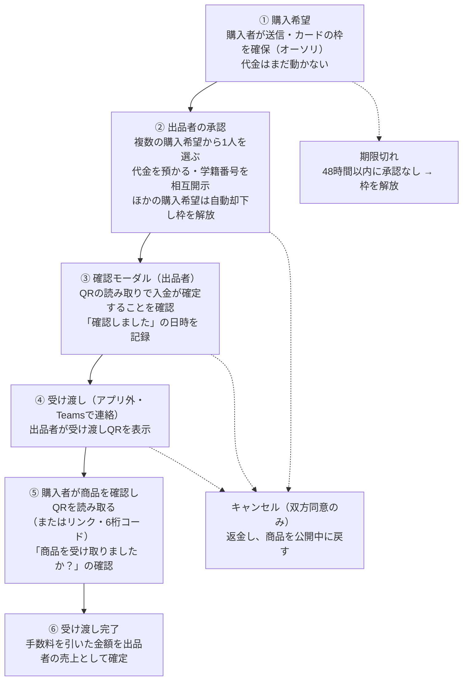
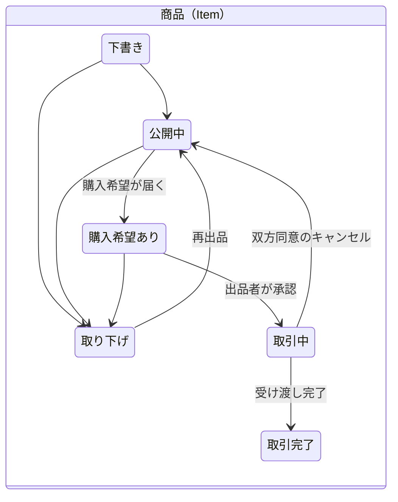
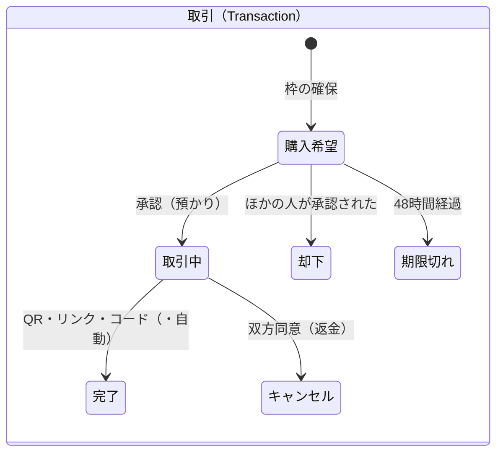

# 取引フロー（要件）

> 関連: [決済・手数料・出金](06-payment.md) / [技術：API](../tech/api.md) / [技術：DB（二重処理の防止）](../tech/database.md) / [技術：定期処理と決済モック](../tech/jobs-payment-mock.md) / 画面: Request, DealRequests, DealConfirm, DealQR, DealScan（[デザイン](../design/README.md)）

## DEAL 取引フロー

購入希望の時点ではカードの枠を確保するだけで、出品者が承認した時点で代金を預かり、購入者がQRを読み取った時点で出品者の売上として確定します。連絡と受け渡しはアプリの外で行います。

<!-- 元文書の図「取引の流れ · 6段階とキャンセル」は書き出し時に失われたため、本文の記述から Mermaid で復元した -->

**図：取引の流れ · 6段階とキャンセル**（本文から復元）

**図：ステータスの遷移**（本文とデータモデルから整理）

- 取引中からは取り下げられない（[ITEM](03-listing.md)、[ADR 0016](../decisions/0016-item-edit-withdraw-rules.md)）。購入希望ありの間に購入希望がすべて期限切れ・却下になったときの商品ステータスは、本文に明記がないため実装時に確認する（[未決事項](open-questions.md)）。

受け渡しが成立しなかった場合は、双方の同意で取引をキャンセルし、代金を返金して商品を公開中に戻します。

### DEAL-1 購入希望と出品者の承認

出品者が承認するまで学籍番号は開示しません。これにより、出品者が取引相手を選べるようになります。

1. 購入者が「購入希望」を出すと、支払い方法の枠を確保します（カードのオーソリ）。この時点では代金は動きません。
2. 1つの商品に複数の購入希望を受け付けます。出品者は一覧から1人を選んで承認します。
3. 承認されると代金を預かり、取引成立として双方の学籍番号をシステムが開示します。選ばれなかった購入希望は自動で却下し、枠を解放します。
4. 48時間以内に承認されなかった購入希望は期限切れとし、枠を解放します。カードのオーソリには有効期限があるため、この期限は短めにしています。

商品のステータスは「公開中 → 購入希望あり → 取引中 → 取引完了」と進みます。購入希望ありの間も、ほかの人は購入希望を出せます。

### DEAL-2 出品者への確認モーダル

取引が成立したとき、出品者に次の内容のモーダルを表示します。

> 入金は、受け渡しの場で購入者がQRコードを読み取った時点で確定します。受け渡しの際は、忘れずにQRコードを読み取ってもらってください。

- 出品者が「確認しました」を押した日時を記録します。
- これ以降、QRの読み取り忘れによる不利益について運営は責任を負いません。この旨を利用規約にも明記します。

### DEAL-3 受け渡し完了の確認（QRコード）

受け渡しの場で出品者がQRコードを表示し、購入者がそれを読み取ると、受け渡し完了と出品者への代金の確定が同時に行われます。代金が動くきっかけを購入者の操作にすることで、商品を受け取る前にお金が渡ることを防ぎます。

1. 出品者が取引詳細画面で「受け渡しQRを表示」を押すと、その取引専用のQRコードが表示されます。
2. 購入者は商品を確認してから、取引詳細画面の「QRを読み取る」でコードを読み取ります。
3. サーバーで照合できたら、取引を「受け渡し完了」にし、手数料を引いた金額を出品者の売上として確定します。
4. 双方の画面に完了が表示されます。

**QRコードの仕様**

- 中身は取引IDと使い捨てのトークンだけにします。個人情報や金額は含めません。
- 有効期限は短くし（例：5分）、期限が切れたら表示し直せるようにします。
- 読み取れるのは、その取引の購入者としてログインしている人だけにします。ほかの人が読み取ってもエラーにします。
- 一度使ったトークンは無効にし、同じ取引が二重に完了しないようにします。
- カメラが使えない場合に備え、QRの下に6桁の確認コードも表示し、手入力でも完了できるようにします。

**QRを読み忘れた場合**

- 出品者が取引詳細画面から「完了リンク」か「6桁の完了コード」を発行し、Teamsで購入者に送ります。
- 購入者がログインした状態でリンクを開くか、コードを入力すると受け渡し完了になります。完了させるのが購入者の操作であることはQRと同じです。
- リンクとコードの有効期限は24時間とし、一度使ったら無効にします。
- 購入者が完了する前に「商品を受け取りましたか？」という確認を表示し、受け取る前に完了させられることを防ぎます。QRの読み取り時も同じ確認を表示します。

### DEAL-4 キャンセルのルール

- 取引成立後のキャンセルは、双方が同意した場合にだけできます。どちらか一方だけではキャンセルできません。
- 受け渡し完了後は、アプリ上でキャンセルや返金はできません。
- キャンセルの回数を記録し、回数が多い利用者には警告やアカウント停止で対応します。

### DEAL-5 自動完了（暫定・導入するか要検討）

**この仕組みは暫定案で、導入するかどうかを含めて検討中です。**

購入者が商品を受け取った後にQRを読み取らない場合、双方同意のキャンセルルールのもとでは代金が預かられたまま止まってしまいます。これを防ぐ案として、次の仕組みを考えています。

- 取引成立から7日経過したら、自動で受け渡し完了にして出品者の売上を確定します。
- 期限の前に、双方へ催促の通知を送ります。
- 運営は仲裁しません。購入者が「受け取っていない」と申告しても、自動完了は止めません。

導入しない場合は、止まった取引をどう扱うか（運営が手動で処理するか、双方同意を待ち続けるか）を別に決める必要があります。
