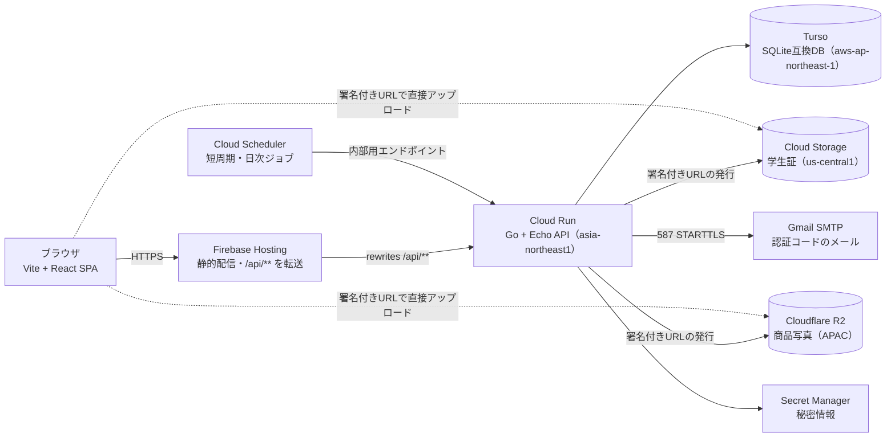

# 佐賀大お下がりフリマ 技術構成

要件定義書とは別に、技術の選定と構成をまとめるドキュメントです。費用をできるだけかけないことを優先しています。

> 機能別に分割した技術構成の先頭ファイルです。全体の索引は [docs/README.md](../README.md)、要件は [product/00-overview.md](../product/00-overview.md) を参照してください。

## ARCH 構成の全体像

Firebase Hosting は静的ファイルの配信だけを担当し、ログイン、取引、トークンの照合などの処理はすべて Cloud Run のAPIで行います。

<!-- 元文書の図「技術構成 · 7つのサービス」は書き出し時に失われたため、本文の記述から Mermaid で復元した -->

**図：技術構成**（本文から復元。商品写真の R2 は [ADR 0051](../decisions/0051-item-images-on-cloudflare-r2.md) で追加）

画像だけは、APIが発行した署名付きURLを使って、ブラウザから Cloud Storage（学生証）・Cloudflare R2（商品写真）に直接アップロードします（点線）。

- **置き場所**：Google Cloud と Firebase は1つのプロジェクト `osagari-web-dev` にまとめます。Cloud Run と Turso は東京、Cloud Storage（学生証）は常時無料枠のある米国（us-central1）に置きます（[ADR 0041](../decisions/0041-production-regions-and-domain.md)）。商品写真は Cloudflare R2 に置き、アジア太平洋（APAC）の location hint を付けます（[ADR 0051](../decisions/0051-item-images-on-cloudflare-r2.md)）。
- **本番環境の作り方**：Cloud Run のサービス・マイグレーション用のジョブ・Secret Manager・Artifact Registry は `infra/` の gcloud スクリプトで作り、手順は [infra/README.md](../../infra/README.md) にまとめます（[ADR 0042](../decisions/0042-cloud-run-secret-manager-deploy.md)）。
- **デプロイ**：main への push（dev → main のマージ）で、GitHub Actions が API と画面を本番に出します。dev への push では出しません。GCP へは Workload Identity 連携で入り、鍵は置きません（[ADR 0045](../decisions/0045-hosting-and-ci-deploy.md)）。
- **ドメイン**：独自ドメインは使わず、Firebase Hosting の標準ドメイン（`<サイト名>.web.app`）で公開します（[ADR 0041](../decisions/0041-production-regions-and-domain.md)）。

> 各要素の詳細: [frontend.md](frontend.md) / [api.md](api.md) / [auth.md](auth.md) / [database.md](database.md) / [storage.md](storage.md) / [jobs-payment-mock.md](jobs-payment-mock.md)

## COST 費用の見込み

学内アプリの規模であれば、月の費用はほぼ0円の見込みです。ただし Cloud Run と Cloud Storage を使うには Google Cloud の課金アカウントが、R2 を使うには Cloudflare へのカードの登録が必要です。

| サービス | 想定プラン | 月額の目安 |
| --- | --- | --- |
| Firebase Hosting | Blaze（Cloud Run のために請求先アカウントに紐づけたプロジェクトなので、自動でこのプランになる。無料枠内） | 0円 |
| Cloud Run | 無料枠内 | 0円 |
| Cloud Scheduler | 無料枠内（ジョブ2つ） | 0円 |
| Secret Manager | 無料枠内（有効なバージョン6個・アクセス月1万回） | 0円 |
| Artifact Registry | 無料枠内（0.5GB） | 0円 |
| Cloud Storage | 常時無料枠（us-central1、5GB。学生証だけ） | 0円 |
| Cloudflare R2 | 無料枠内（保存10GB・書き込み月100万回・読み取り月1,000万回。転送料はかからない） | 0円 |
| Turso | Free | 0円 |
| Gmail | 無料アカウント | 0円 |
| Cloud Monitoring | アラートポリシー1件（送信数の通知） | 0円（2027年9月以降は課金の予定。下記） |

- 無料枠に収めるための設定（[ADR 0042](../decisions/0042-cloud-run-secret-manager-deploy.md)）：Cloud Run は最小0台・最大2台で、CPU はリクエストの処理中だけ割り当てます（マイグレーションのジョブも同じ無料枠に入ります）。Secret Manager はシークレットごとに有効なバージョンを1つだけにし、値は起動時に読むのでアクセスはインスタンスの起動回数分です。Artifact Registry は最新3件より古いイメージを自動で消します。
- Cloud Monitoring のアラートは今は無料ですが、2027年9月以降に課金が始まる予定です（ログベースのアラートポリシーは1件あたり月数十円以下の見込み。開始の90日前に通知が来ます）。通知が来たら、続けるかどうかを見直します（[ADR 0044](../decisions/0044-production-gmail-smtp.md)）。
- 課金アカウントには予算アラート（月500円。50%・90%・100%で請求先アカウントの管理者と運用通知のチャンネルに通知）を設定し、想定外の課金にすぐ気づけるようにします（[ADR 0046](../decisions/0046-cloud-scheduler-and-budget-alert.md)）。
- 商品写真は利用者が見るたびに読まれるので、転送料のかからない R2 に置き、アクセスが増えたときや悪用されたときの費用を抑えます。読み取りが月1,000万回を超えると、100万回あたり約$0.36 かかります（[ADR 0051](../decisions/0051-item-images-on-cloudflare-r2.md)）。
- 有料プランが必要になる主なきっかけは、Gmailの送信上限（1日約500通）を超えたときと、Tursoの無料枠を超えたときです。
