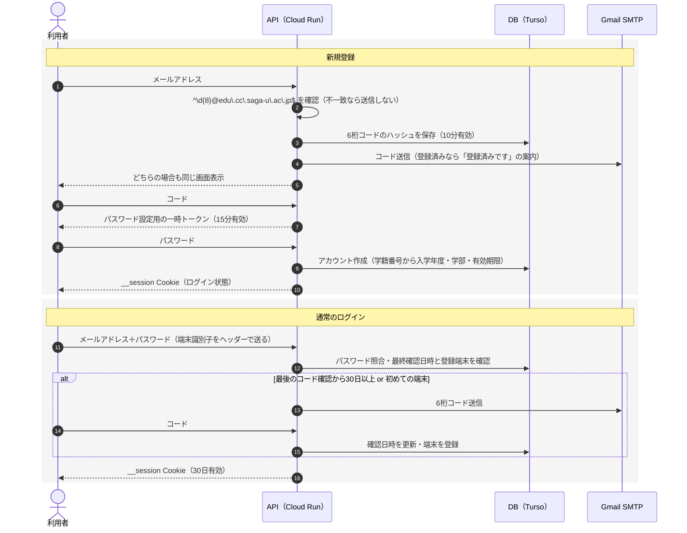

# 認証（技術）

> 関連: [ユーザー・認証・アカウント期限（要件）](../product/01-account-auth.md) / [API](api.md) / 画面: Login, SignUp, Code, Password, Recheck（[デザイン](../design/README.md)）

## AUTHN 認証

普段はメールアドレスとパスワードでログインし、新規登録時と定期的な再確認のときだけ、メールで届く6桁のコードを使います。大学のMicrosoftアカウントでのログインは使えないため自前で実装し、メールは Gmail のSMTPで送ります。

<!-- 元文書の図「ログインの流れ · 新規登録と通常のログイン」は書き出し時に失われたため、本文の記述から Mermaid で復元した -->

**図：ログインの流れ · 新規登録と通常のログイン**（本文から復元）

### AUTHN-1 コードを使う理由

メール内のリンクを開く方式ではなく、6桁のコードを入力する方式にします。

- 大学のMicrosoft 365では、セキュリティ機能がメール内のリンクを自動で開いて確認することがあります。一度しか使えないリンクだと、利用者が開く前に使用済みになるおそれがあります。
- PCで手続きしながらスマホでメールを見る、といった使い方でもそのまま使えます。

### AUTHN-2 新規登録

1. 利用者がメールアドレスを入力します。サーバーで `^\d{8}@edu\.cc\.saga-u\.ac\.jp$` に一致するか確認し、一致しなければ送信しません。学籍番号から計算した有効期限（[AUTH-3](../product/01-account-auth.md)）を過ぎていても、`signup_period_ended` を返して送信しません。学籍番号だけで決まり登録の有無に関係しないので、登録済みかどうかを調べる前に判定します（推定・コード確認・アカウント作成でも同じ判定をします）。
2. 6桁のコードを生成し、ハッシュ化してDBに保存したうえで、Gmail SMTPで送ります。有効期限は10分です。すでに登録済みのアドレスには、コードの代わりに「登録済みです」という案内を送り、画面上はどちらも同じ表示にします。登録の有無を画面から調べられないようにするためです。
3. コードが一致したら、パスワード設定用の一時トークン（15分有効）を発行します。
4. 利用者がパスワードを設定すると、アカウントを作成します。学籍番号から入学年度、学部、有効期限を計算して登録し、そのままログイン状態にします。

- **登録の有無を隠す方法**：登録済みのアドレスにも、未登録と同じようにコードを生成・保存し、メールを1通送ります（本文だけが違い、コードは書かない）。応答・所要時間・その後のコード確認の応答が同じになります。
- **一時トークン**は `password_setup_tokens` に SHA-256 で保存し、一度だけ使えます（パスワード再設定でも使う）。
- **入力中の推定表示**（SignUp 画面）には、登録状態に触れない推定 API（`POST /auth/signup/estimate`）を使います。学部の表はサーバーの1か所だけに置きます。
- 詳しい理由は [ADR 0007](../decisions/0007-signup-flow.md)。

### AUTHN-3 通常のログイン

1. 利用者がメールアドレスとパスワードを入力します。
2. パスワードが一致したら、次のどちらかに当てはまるか確認します。
   - 最後にコードで確認してから30日以上たっている
   - 初めて使う端末である
3. 当てはまる場合はメールで6桁のコードを送り、入力されたら確認日時を更新して端末を登録します。当てはまらなければ、そのままログインできます。
4. セッションを発行します。有効期間は30日です。

- **端末の識別**：Firebase Hosting を経由すると `__session` 以外のCookieが削除されるため、端末識別子はブラウザの localStorage に保存し、ログイン時にヘッダー（`X-Device-Id`）で送ります。ヘッダーがなければ初めての端末として扱います。
- **再確認の手続き**：パスワードが一致して再確認が必要なときは、コードを送り、ログインチャレンジ（`login_challenges`、15分有効・一度だけ使える。SHA-256 で保存）を返します。コードの確認と再送はこのチャレンジで行い、パスワードを再び送らせません。ログイン時の端末をチャレンジに保存しておき、確認に成功したら、最後の確認日時の更新・その端末の登録・セッションの発行をまとめて行います。理由は「30日経過」（`code_expired`）と「初めての端末」（`new_device`）で、両方に当てはまるときは30日経過にします。
- **利用できないアカウント**：メールアドレスの形式違い・未登録・削除済み・パスワード違いは区別せずに同じエラーを返し、未登録でも同じだけ照合の計算をします（登録の有無を判別させない）。パスワードが一致したときだけ、停止中・失効（有効期限の日を日本時間で過ぎた場合を含む）であることを伝えます。
- 詳しい理由は [ADR 0009](../decisions/0009-login-recheck-challenge.md)。
- **卒業後の扱い**：卒業して大学のメールが使えなくなるとコードを受け取れないため、遅くとも30日後にはログインできなくなります。有効期限による失効を補う仕組みにもなります。

### AUTHN-4 パスワードの再設定

1. 利用者がメールアドレスを入力すると、6桁のコードを送ります。
2. コードが一致したら新しいパスワードを設定し、その利用者の既存のセッションをすべて無効にします。

- **手続き**：コードの確認に成功したら、新規登録と同じ一時トークン（`password_setup_tokens`、purpose = `password_reset`、15分有効・一度だけ使える）を発行し、新しいパスワードはこのトークンで受け取ります。コードは `verification_codes`（purpose = `password_reset`）を使い、有効期限・入力ミスの上限は新規登録と同じです（AUTHN-6）。
- **登録の有無を隠す方法**：未登録・削除済みのアドレスにも、登録済みと同じようにコードを生成・保存し、メールを1通送ります（本文は「登録されていません」の案内で、コードは書かない）。応答・所要時間・その後のコード確認の応答が同じになります（AUTHN-2 と同じ考え）。
- **設定した後**：パスワードの入力ミスの回数を0に戻し（ログインを止めている間は期限まで止めたまま。AUTHN-6）、既存のセッションをすべて失効させたうえで、この端末用の新しいセッションを発行してログイン状態にします。コードで本人確認をしたので最後の確認日時を更新し、`X-Device-Id` があればその端末を登録します（AUTHN-3）。パスワードの更新・セッションの失効と発行・端末の登録は1つのトランザクションで行います。
- **停止中・失効のアカウント**：コードは同じように送りますが、新しいパスワードを設定するときに停止中・失効であることを伝えて断り、パスワードは変えません（一時トークンも使わずに残す）。
- 詳しい理由は [ADR 0010](../decisions/0010-password-reset.md)。

### AUTHN-5 パスワードとセッションの扱い

- パスワードは argon2id でハッシュ化して保存します。長さは10文字以上128文字以下とします（文字数で数える。上限の理由は [ADR 0008](../decisions/0008-password-max-length.md)）。
- セッションIDは `__session` という名前のCookieに入れます（HttpOnly、Secure、SameSite=Lax）。セッションはDBで管理し、ログアウトや強制停止ですぐ無効にできるようにします。
- セッションが有効なのは、失効しておらず発行から30日以内（延長しない）で、ユーザーが有効（停止・失効・削除でない）なときだけです。API の操作は、API 契約で認証不要（`security: []`）としたもの以外すべてセッションを必要とします。ログアウトはいまのセッションだけを無効にし、ログインしていなくても成功として扱います（[ADR 0009](../decisions/0009-login-recheck-challenge.md)）。
- **DBに秘密の値を平文で置かない**（[ADR 0006](../decisions/0006-auth-secret-hashing.md)）：
  - セッションIDは推測できない乱数（256ビット）を Cookie に入れ、DB には SHA-256 のハッシュだけを保存します。端末識別子も同じく SHA-256 で保存します。
  - 6桁の認証コードは候補が100万通りしかなく SHA-256 では総当たりで戻せるため、パスワードと同じ argon2id でハッシュ化します。

### AUTHN-6 不正対策と送信数の制限

- パスワードの入力ミスが10回続いたら、15分間そのアカウントのログインを止めます。
  - 回数は**メールアドレスごと**に数えます（`login_failures`）。未登録・削除済みのアドレスも同じように数えて止め、止まるかどうかから登録の有無を判別させません（AUTHN-2）。
  - 回数は照合の**前に**数え、同時に大量に入力されても照合は10回までにします。止めている間は正しいパスワードでも照合せず `429 too_many_requests` を返します。15分たったら回数を0から数え直します。
  - パスワードが一致したら回数を0に戻します（停止中・失効・再確認が必要で、ログインまで進まない場合も含む）。
  - パスワード再設定（AUTHN-4）に成功したら回数を0に戻しますが、止めている間は期限まで止めたままにします。
  - 24時間入力ミスがなければ記録を消し、回数を0に戻します（止めている間の記録は消しません）。消すのは短周期ジョブです（[JOBS-1](jobs-payment-mock.md)）。
- 同じアドレスへのコード送信は1分に1回、1時間に5回までにします。用途（新規登録・パスワード再設定・ログインの再確認）をまとめて数え、超えたら送らずに `429 too_many_requests` を返します。登録の有無にかかわらず同じように数えます。断ったときは、それまでのコードがそのまま使えます。
- コードの入力ミスは5回までとし、超えたらそのコードを無効にします。回数は照合の**前に**数え、同時に大量に入力されても1つのコードを照合できるのは5回までにします（[ADR 0007](../decisions/0007-signup-flow.md)）。
- 無料のGmailアカウントは1日の送信数がおよそ500通までです。コードを送るのは登録時と再確認時だけなので通常は収まりますが、全体の送信数も記録して上限に近づいたら管理者に知らせます。
  - 送信数は `verification_codes` の行数（コードのメール1通＝1行）で数えます。そのため `verification_codes` の行は、期限が切れても作ってから24時間は消しません。直近24時間で400通以上になったら、送るたびに警告（WARN）のログを出します。送信は止めません。このログが出たら Cloud Monitoring のログベースのアラートで運用者にメールで知らせます（1時間に1回まで。`infra/setup.sh`、[ADR 0044](../decisions/0044-production-gmail-smtp.md)）。
- 制限はアドレス単位だけです。IP 単位の制限は、送信元IPの取り方（Firebase Hosting 経由）を含めて別に検討します。端末識別子は利用者側で消せるため、制限には使いません。
- 詳しい理由は [ADR 0011](../decisions/0011-rate-limits.md)。

### AUTHN-7 Gmail SMTPの設定

- アプリ専用のGmailアカウントを作り、2段階認証を有効にしてアプリパスワードで送信します。
- 本番の設定（[ADR 0044](../decisions/0044-production-gmail-smtp.md)、手順は [infra/README.md](../../infra/README.md)）：送信に使うアドレス（`SMTP_USERNAME`）と差出人（`SMTP_FROM`、表示名は「佐賀大お下がりフリマ 運営」）は秘密ではないので `infra/config.sh` に書き、アプリパスワード（`SMTP_PASSWORD`）は Secret Manager の `smtp-password` に置きます。
- Cloud Run からは587番ポート（STARTTLS）で接続します。25番ポートは使えません。
- 大学のメールで迷惑メールに振り分けられないか、運用前に実際に送って確認します。

**教職員への対応（検討保留）**：上の正規表現は学生（数字8桁）だけを受け付けます。教職員用には数字以外も受け付ける別の登録・ログインの経路を用意する前提ですが、受け付けるドメインなどの詳細は未定です。
