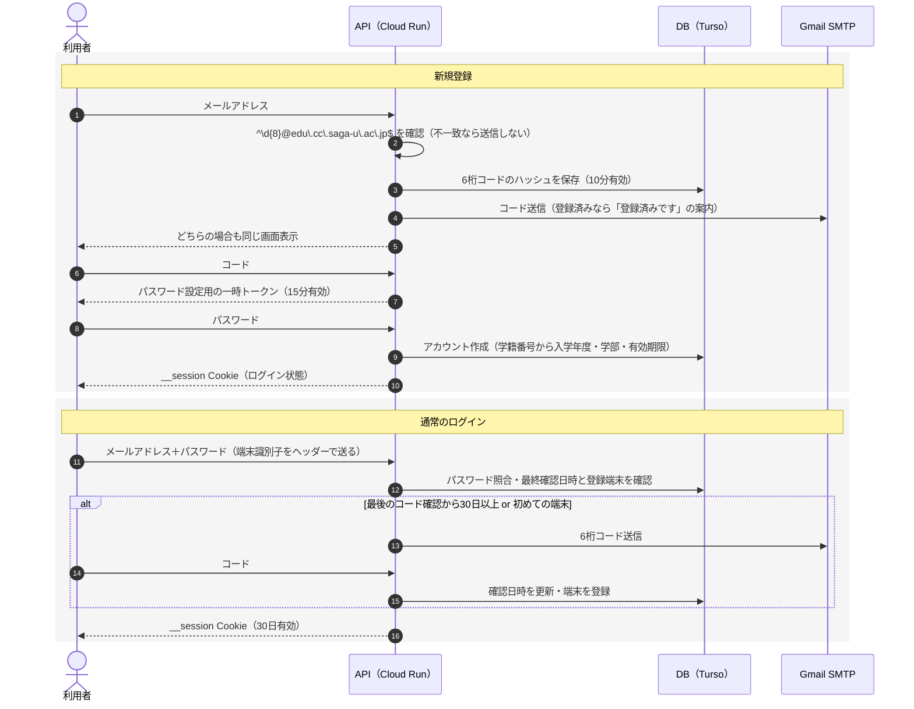

# 認証（技術）

> 関連: [ユーザー・認証・アカウント期限（要件）](../product/01-account-auth.md) / [API](api.md) / 画面: Login, SignUp, Code, Password, Recheck（[デザイン](../design/README.md)）

## AUTHN 認証

普段はメールアドレスとパスワードでログインし、新規登録時と定期的な再確認のときだけ、メールで届く6桁のコードを使います。大学のMicrosoftアカウントでのログインは使えないため自前で実装し、メールは Gmail のSMTPで送ります。

<!-- 元文書の図「ログインの流れ · 新規登録と通常のログイン」は書き出し時に失われたため、本文の記述から Mermaid で復元した -->

**図：ログインの流れ · 新規登録と通常のログイン**（本文から復元）

### AUTHN-1 コードを使う理由

メール内のリンクを開く方式ではなく、6桁のコードを入力する方式にします。

- 大学のMicrosoft 365では、セキュリティ機能がメール内のリンクを自動で開いて確認することがあります。一度しか使えないリンクだと、利用者が開く前に使用済みになるおそれがあります。
- PCで手続きしながらスマホでメールを見る、といった使い方でもそのまま使えます。

### AUTHN-2 新規登録

1. 利用者がメールアドレスを入力します。サーバーで `^\d{8}@edu\.cc\.saga-u\.ac\.jp$` に一致するか確認し、一致しなければ送信しません。
2. 6桁のコードを生成し、ハッシュ化してDBに保存したうえで、Gmail SMTPで送ります。有効期限は10分です。すでに登録済みのアドレスには、コードの代わりに「登録済みです」という案内を送り、画面上はどちらも同じ表示にします。登録の有無を画面から調べられないようにするためです。
3. コードが一致したら、パスワード設定用の一時トークン（15分有効）を発行します。
4. 利用者がパスワードを設定すると、アカウントを作成します。学籍番号から入学年度、学部、有効期限を計算して登録し、そのままログイン状態にします。

### AUTHN-3 通常のログイン

1. 利用者がメールアドレスとパスワードを入力します。
2. パスワードが一致したら、次のどちらかに当てはまるか確認します。
   - 最後にコードで確認してから30日以上たっている
   - 初めて使う端末である
3. 当てはまる場合はメールで6桁のコードを送り、入力されたら確認日時を更新して端末を登録します。当てはまらなければ、そのままログインできます。
4. セッションを発行します。有効期間は30日です。

- **端末の識別**：Firebase Hosting を経由すると `__session` 以外のCookieが削除されるため、端末識別子はブラウザの localStorage に保存し、ログイン時にヘッダーで送ります。
- **卒業後の扱い**：卒業して大学のメールが使えなくなるとコードを受け取れないため、遅くとも30日後にはログインできなくなります。有効期限による失効を補う仕組みにもなります。

### AUTHN-4 パスワードの再設定

1. 利用者がメールアドレスを入力すると、6桁のコードを送ります。
2. コードが一致したら新しいパスワードを設定し、その利用者の既存のセッションをすべて無効にします。

### AUTHN-5 パスワードとセッションの扱い

- パスワードは argon2id でハッシュ化して保存します。長さは10文字以上とします。
- セッションIDは `__session` という名前のCookieに入れます（HttpOnly、Secure、SameSite=Lax）。セッションはDBで管理し、ログアウトや強制停止ですぐ無効にできるようにします。

### AUTHN-6 不正対策と送信数の制限

- パスワードの入力ミスが10回続いたら、15分間そのアカウントのログインを止めます。
- 同じアドレスへのコード送信は1分に1回、1時間に5回までにします。
- コードの入力ミスは5回までとし、超えたらそのコードを無効にします。
- 無料のGmailアカウントは1日の送信数がおよそ500通までです。コードを送るのは登録時と再確認時だけなので通常は収まりますが、全体の送信数も記録して上限に近づいたら管理者に知らせます。

### AUTHN-7 Gmail SMTPの設定

- アプリ専用のGmailアカウントを作り、2段階認証を有効にしてアプリパスワードで送信します。
- Cloud Run からは587番ポート（STARTTLS）で接続します。25番ポートは使えません。
- 大学のメールで迷惑メールに振り分けられないか、運用前に実際に送って確認します。

**教職員への対応（検討保留）**：上の正規表現は学生（数字8桁）だけを受け付けます。教職員用には数字以外も受け付ける別の登録・ログインの経路を用意する前提ですが、受け付けるドメインなどの詳細は未定です。
